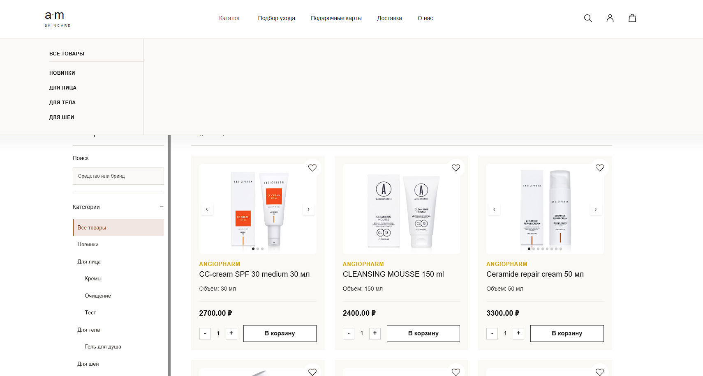
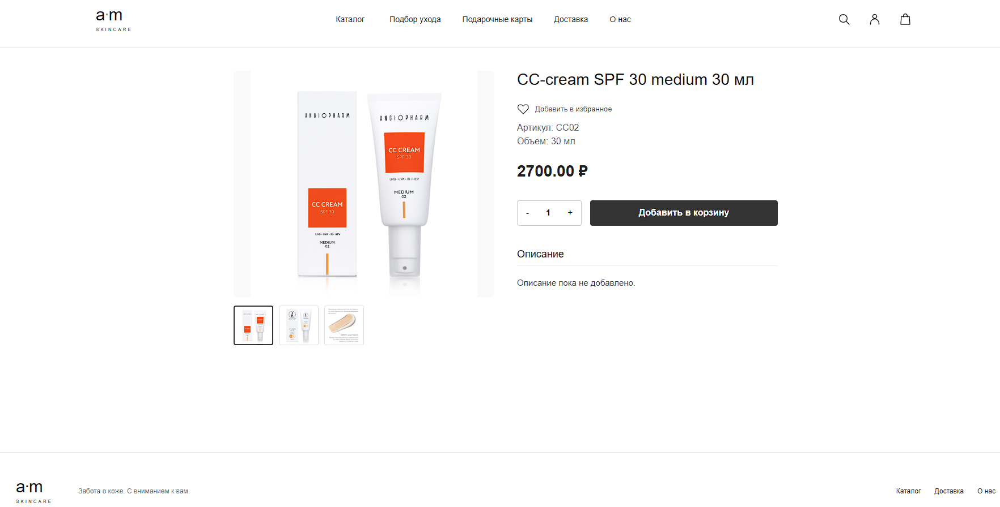
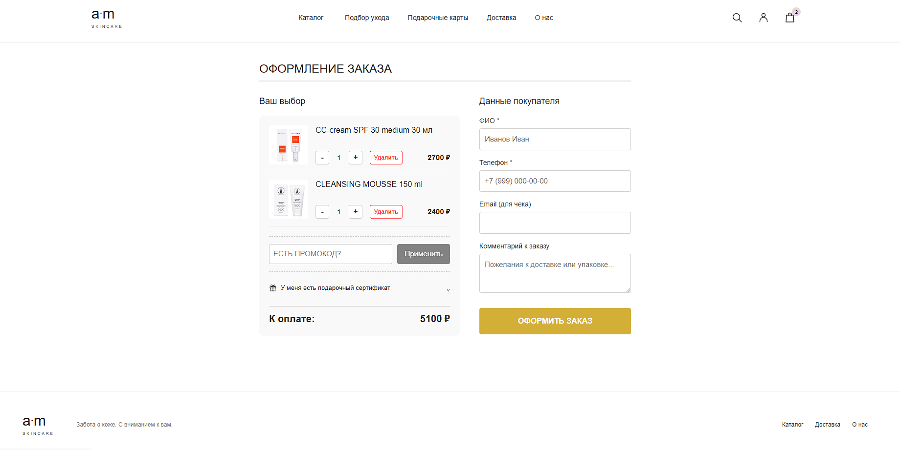
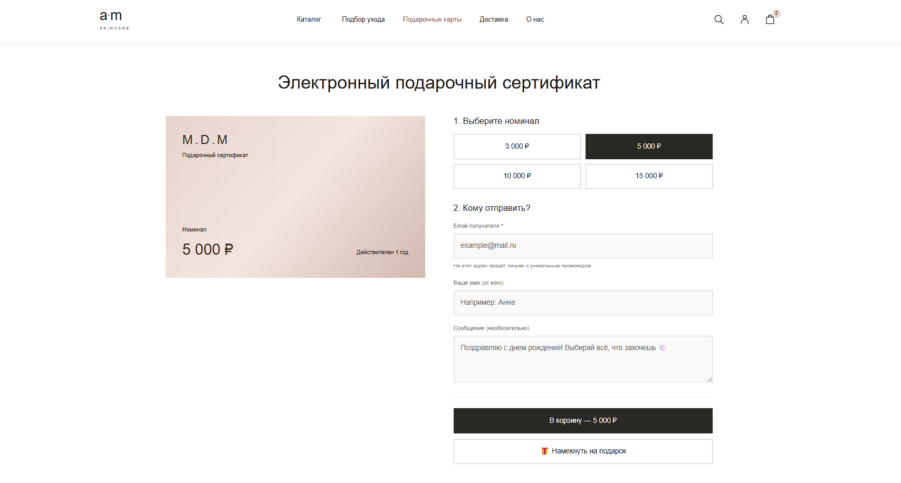
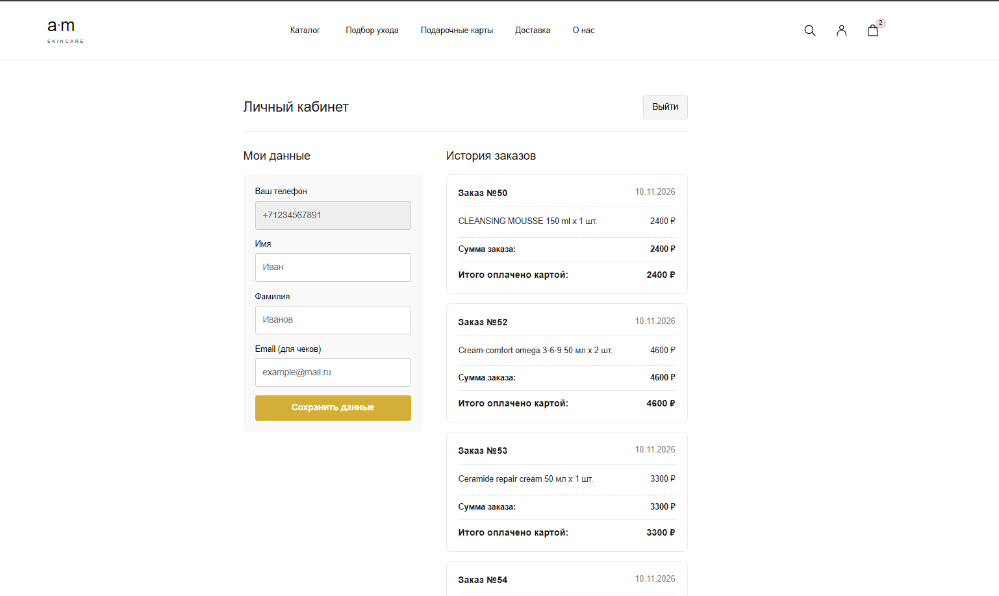
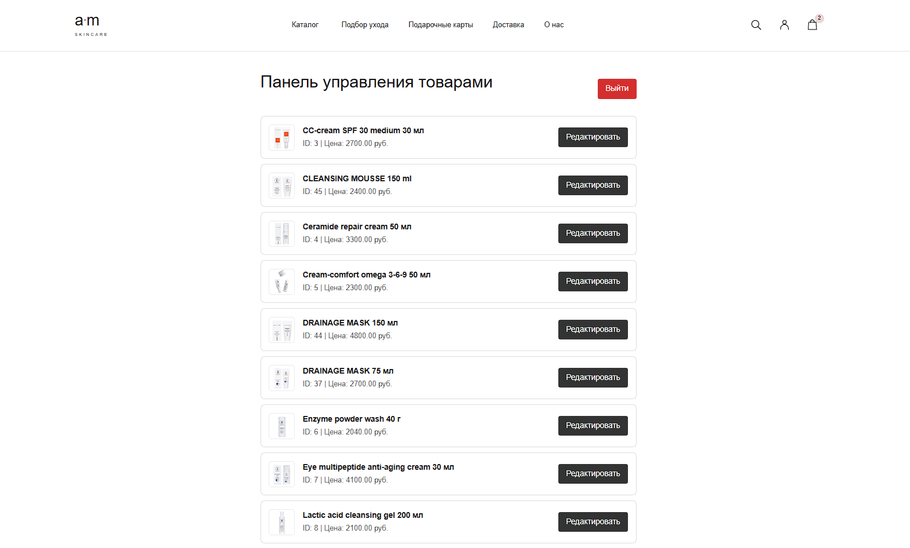
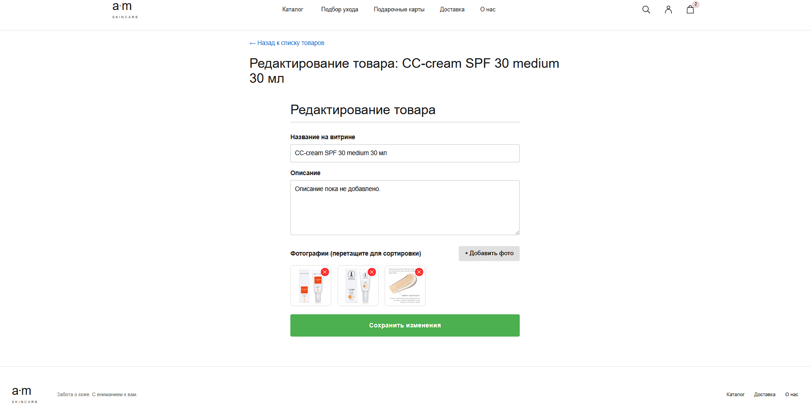
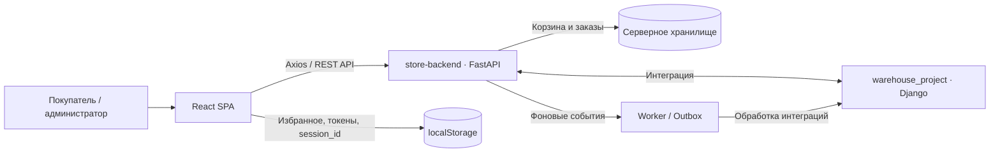

# Store Frontend

**Клиентское приложение интернет-магазина профессиональной косметики** — часть системы **Warehouse & Store**, которая объединяет витрину, backend API и складской учёт.


> Репозиторий на GitHub называется `store-fronted`, а имя приложения в `package.json` — `store-frontend`.

**Навигация:** [Возможности](#возможности) · [Скриншоты](#интерфейс-приложения) · [Архитектура](#архитектура) · [Технологии](#технологический-стек) · [Запуск](#быстрый-старт) · [API](#используемые-api-маршруты) · [Docker](#docker)

## О проекте

Store Frontend — клиентская часть **действующего интернет-магазина** на **React**. Покупатели используют интерфейс для выбора косметики и оформления заказов, а администратор — отдельные страницы для управления товарами. Приложение работает в связке с API магазина и складским сервисом.

Приложение обращается к REST API сервиса **[store-backend](https://github.com/linkolnn-pixel/store-backend)** на **FastAPI**. Данные об ассортименте и складских операциях в общей системе связаны с **[warehouse_project](https://github.com/linkolnn-pixel/warehouse_project)**. Фронтенд не управляет базой данных, складом, фоновыми задачами и отправкой уведомлений напрямую: эти обязанности находятся на стороне серверных компонентов.

### Возможности

**Для покупателя**

- **Каталог товаров:** загрузка ассортимента и категорий через API, раздел «Новинки».
- **Поиск и фильтрация:** по названию/бренду, древовидным категориям и брендам; параметры сохраняются в URL.
- **Галерея товара:** переключение изображений, увеличение фотографии при наведении на десктопе, отдельная страница товара.
- **Избранное:** добавление и удаление товаров, сохранение в `localStorage` и синхронизация между вкладками.
- **Корзина:** добавление позиций, изменение количества, удаление, актуальный счётчик товаров в навигации.
- **Промокоды:** применение и отмена промокода с перерасчётом корзины на сервере.
- **Подарочные сертификаты:** выбор номинала и получателя, добавление сертификата в корзину; проверка кода и остатка сертификата при оформлении заказа.
- **Оформление заказа:** контактная форма, комментарий, передача заказа в API; переход по `payment_url`, если бэкенд его возвращает.
- **Личный кабинет:** вход по коду, история заказов, редактирование локально сохранённых контактных данных.

**Для администратора**

-  Вход в административный интерфейс с токеном доступа.
-  Просмотр каталога товаров.
-  Редактирование маркетингового названия и описания товара.
-  Загрузка изображений и управление их порядком через drag-and-drop.
-  Защита клиентских админ-маршрутов компонентом `ProtectedRoute`; операции на сервере должны дополнительно проверять права доступа.

## Интерфейс приложения

Ниже — реальные скриншоты работающего интернет-магазина **a·m SKINCARE**.

### Главная страница


### Каталог и карточка товара

| Каталог с поиском и фильтрацией | Карточка товара с галереей и добавлением в корзину |
| :---: | :---: |
|  |  |

### Оформление заказа и сертификаты

| Корзина и оформление заказа | Электронный подарочный сертификат |
| :---: | :---: |
|  |  |

### Личный кабинет

<p align="center">
  
</p>

### Администрирование каталога

| Список товаров | Редактирование карточки и фотографий |
| :---: | :---: |
|  |  |

## Архитектура



### Как оформляется заказ

1. Пользователь открывает каталог; React запрашивает товары и категории через `GET /api/v1/catalog` и `GET /api/v1/catalog/categories`.
2. При добавлении товара фронтенд отправляет запрос в `store-backend`. Идентификатор сессии корзины (`session_id`) сохраняется в браузере, а сама корзина обслуживается бэкендом.
3. В корзине пользователь меняет количество, вводит промокод или проверяет подарочный сертификат и заполняет контактные данные.
4. Фронтенд вызывает `POST /api/v1/checkout` и передаёт `session_id`, данные покупателя, комментарий и при необходимости код сертификата.
5. Если ответ содержит `payment_url`, браузер переходит по ссылке; иначе отображается страница `/success`.
6. Дальнейшая обработка заказа, синхронизация со складом, фоновые задачи и уведомления относятся к серверной части, а не к React-приложению.

> **Важно:** наличие перехода по `payment_url` во фронтенде не означает, что подключён реальный платёжный провайдер. В текущей реализации `store-backend` используется тестовый сценарий оплаты.

## Технологический стек

| Технология | Назначение |
| --- | --- |
| **React 19** | Компоненты, хуки, состояние интерфейса |
| **JavaScript (ES Modules)** | Логика приложения |
| **Vite 8** | Dev-сервер и production-сборка |
| **React Router 7** | Маршрутизация SPA и защищённые страницы |
| **Axios** | HTTP-запросы к FastAPI |
| **Context API** | Глобальное состояние корзины и избранного |
| **CSS** | Стили страниц, адаптивный интерфейс |
| **localStorage** | Сессия корзины, токены и локальное избранное |
| **ESLint** | Проверка JavaScript/React-кода |
| **Docker + Nginx** | Сборка и раздача статических файлов |

## Страницы приложения

| Маршрут | Назначение |
| --- | --- |
| `/` | Главная страница магазина |
| `/catalog` | Каталог с поиском и фильтрами |
| `/product/:id` | Карточка товара |
| `/favorites` | Избранные товары |
| `/cart` | Корзина и оформление заказа |
| `/certificates` | Подарочные сертификаты |
| `/profile` | Авторизация покупателя и история заказов |
| `/success` | Подтверждение оформления заказа |
| `/about` | О проекте и специалисте |
| `/services` | Услуги |
| `/delivery` | Доставка |
| `/admin/login` | Вход администратора |
| `/admin` | Список товаров для редактирования |
| `/admin/product/:id` | Редактирование информации и фотографий товара |

Маршруты `/admin` и `/admin/product/:id` защищены на уровне UI. Серверная авторизация при выполнении запросов остаётся обязательной.

## Структура проекта

```text
store-fronted/
├── public/                       # Статические ресурсы
├── src/
│   ├── components/               # Навигация, карточки, фильтры, формы и защита маршрутов
│   │   ├── CatalogFilters.jsx
│   │   ├── FavoriteButton.jsx
│   │   ├── FavoritesSection.jsx
│   │   ├── AdminProductForm.jsx
│   │   ├── ProtectedRoute.jsx
│   │   └── NavBar.jsx
│   ├── context/
│   │   ├── CartContext.jsx       # Счётчик товаров в корзине
│   │   └── FavoritesContext.jsx  # Избранное в localStorage
│   ├── pages/
│   │   ├── Home.jsx
│   │   ├── Catalog.jsx
│   │   ├── ProductPage.jsx
│   │   ├── Cart.jsx
│   │   ├── Profile.jsx
│   │   ├── GiftCertificatePage.jsx
│   │   ├── AdminLogin.jsx
│   │   ├── AdminDashboard.jsx
│   │   └── AdminProductEdit.jsx
│   ├── services/
│   │   ├── api.js                # HTTP-клиент и API-функции
│   │   └── categories.js         # Дерево категорий
│   ├── App.jsx                   # Роутинг и провайдеры
│   ├── main.jsx                  # Точка входа React
│   └── index.css                 # Общие стили
├── Dockerfile                    # Multi-stage сборка Node → Nginx
├── docker-compose.yaml
├── nginx.conf                    # SPA fallback и proxy /uploads/
├── vite.config.js
├── eslint.config.js
└── package.json
```

## Быстрый старт

### Требования

- **Node.js**, совместимый с используемой версией Vite (рекомендуется актуальная LTS).
- **npm**.
- Запущенный **store-backend** с доступным API на `http://127.0.0.1:8000`.

### 1. Установка

```bash
git clone https://github.com/linkolnn-pixel/store-fronted.git
cd store-fronted
npm ci
```

### 2. Запуск бэкенда

Разверните [store-backend](https://github.com/linkolnn-pixel/store-backend) по инструкции из его README. Для локальной разработки фронтенд ожидает API на `http://127.0.0.1:8000/api/v1`.

### 3. Запуск фронтенда

```bash
npm run dev
```

Vite по умолчанию открывает приложение на **http://localhost:5173** (если порт свободен).

### Полезные команды

| Команда | Действие |
| --- | --- |
| `npm run dev` | Локальный сервер разработки |
| `npm run build` | Сборка статики в `dist/` |
| `npm run preview` | Предпросмотр production-сборки |
| `npm run lint` | Проверка кода ESLint |

## Настройка подключения к API

Базовый адрес API сейчас **задан непосредственно в коде**:

```js
// src/services/api.js
export const BACKEND_URL = 'http://127.0.0.1:8000';
const API_URL = `${BACKEND_URL}/api/v1`;
```

Кроме того, на странице сертификатов используется отдельный адрес:

```js
// src/pages/GiftCertificatePage.jsx
const BASE_URL = 'http://localhost:8000';
```

Для другого хоста необходимо обновить **оба адреса** перед сборкой. В текущем репозитории **нет подключённой настройки `VITE_API_URL`**: добавить переменную в `.env` без изменения исходного кода недостаточно. Для production-развёртывания рекомендуется вынести адрес в конфигурацию Vite и настроить CORS либо общий reverse proxy.

## Используемые API-маршруты

Ниже — основные запросы, которые вызывает фронтенд (все пути относительно `/api/v1`):

| Метод | Путь | Назначение |
| --- | --- | --- |
| `GET` | `/catalog` | Каталог товаров |
| `GET` | `/catalog/new_arrivals` | Новинки |
| `GET` | `/catalog/categories` | Категории |
| `GET` | `/catalog/:id` | Информация о товаре |
| `POST` | `/cart/add` | Добавить товар |
| `GET` | `/cart/:session_id` | Получить корзину |
| `POST` | `/cart/update` | Изменить количество |
| `POST` | `/cart/remove` | Удалить позицию |
| `POST` | `/promo/apply` | Применить промокод |
| `DELETE` | `/promo/remove` | Убрать промокод |
| `GET` | `/certificates/validate/` | Проверить сертификат |
| `POST` | `/cart/certificate` | Добавить сертификат в корзину |
| `POST` | `/checkout` | Оформить заказ |
| `POST` | `/customer/request-code` | Запрос кода входа |
| `POST` | `/customer/verify-code` | Подтверждение кода |
| `GET` | `/profile/orders` | История заказов |
| `POST` | `/admin/login` | Авторизация администратора |
| `PATCH` | `/catalog/:id/meta` | Редактирование метаданных |
| `POST` | `/catalog/:id/image` | Загрузка изображения |

Для операций с корзиной используются `session_id`, а для защищённых запросов — `Authorization: Bearer <token>`.

## Docker

В проекте есть **multi-stage Dockerfile**: на этапе сборки выполняются `npm ci` и `npm run build`, после чего готовая папка `dist/` копируется в контейнер Nginx.

Запуск из корня репозитория:

```bash
docker compose up --build -d
```

Фронтенд доступен на **http://localhost:3000** благодаря пробросу `3000:80` в `docker-compose.yaml`.

В `nginx.conf` настроены:

- Раздача React SPA с fallback на `index.html` для вложенных маршрутов.
- Проксирование `/uploads/` в `http://store-backend:8000/uploads/`.

**Обратите внимание:** `docker-compose.yaml` этого репозитория запускает **только фронтенд**. Чтобы `/uploads/` работал, Nginx должен иметь сетевой доступ к контейнеру с DNS-именем `store-backend` (например, в общей Docker-сети). Проксирование `/api/v1/` в текущем `nginx.conf` закомментировано; браузер напрямую обращается к адресу, указанному в `src/services/api.js`. Сам по себе `docker compose up` не запускает FastAPI и складскую систему.

## Связанные репозитории

| Репозиторий | Роль |
| --- | --- |
| **[store-fronted](https://github.com/linkolnn-pixel/store-fronted)** | React-интерфейс интернет-магазина (этот репозиторий) |
| **[store-backend](https://github.com/linkolnn-pixel/store-backend)** | FastAPI: каталог, корзина, оформление заказов, авторизация, интеграции и фоновые процессы |
| **[warehouse_project](https://github.com/linkolnn-pixel/warehouse_project)** | Django: складской учёт, товары и складские операции |


---

**Warehouse & Store** — full-stack система: клиентское приложение интернет-магазина, API для заказов и каталога, а также отдельный сервис складского учёта.
